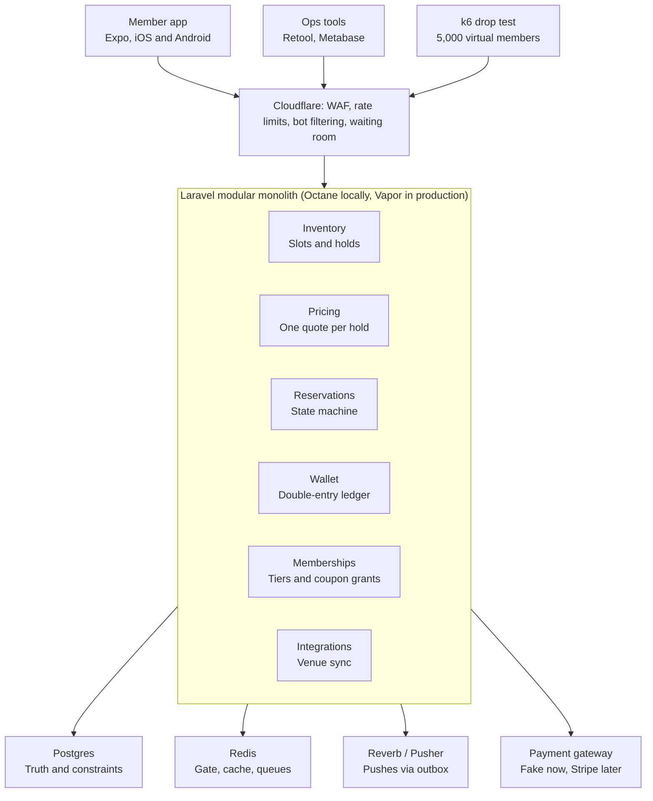
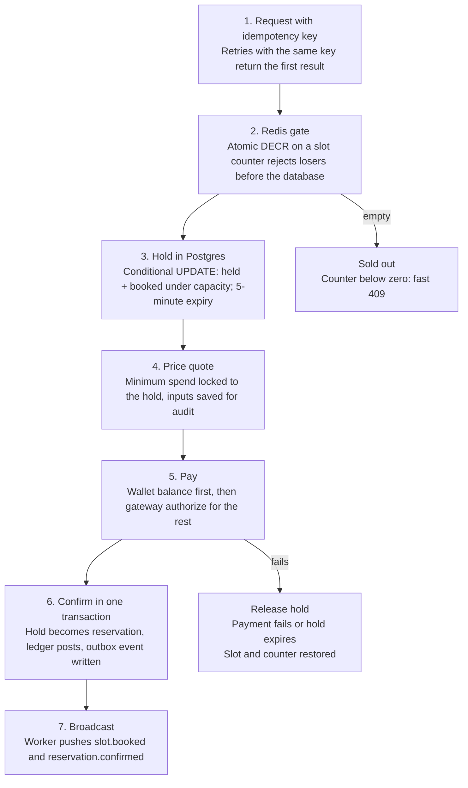

# Dorsia-Scale Build Plan

*October 15, 2026*

A modular Laravel monolith on Postgres and Redis handles Dorsia's likely scale; the hard part is correctness during reservation drops, not raw traffic. A drop is a scheduled release of a venue's tables, which members race to book.

---

## 1. Scale targets

We design for 10x Dorsia's estimated load, so the plan holds through their next growth phase. Only venue and city counts are published; the rest are estimates.

| Metric | Dorsia today (est.) | Design target |
| --- | --- | --- |
| Venues | 400+ (published) | 5,000 |
| Cities | 25 (published) | 100 |
| Bookable slots per day | ~8,000 | 100,000 |
| Members | Tens of thousands | 500,000 |
| Bookings per day | Low thousands | 25,000 |
| Drop burst | Thousands of users on one venue in seconds | 5,000 concurrent users on 50 tables in 10 seconds |
| Booking API p95 latency | Unknown | Under 300 ms during a drop |
| Double bookings | Zero | Zero, proven by load test |
| Ledger drift | Zero | Zero, checked nightly |

The last three rows are the real requirements. Steady traffic at this size fits on one Postgres primary.

---

## 2. Architecture

A single Laravel app with six internal modules mirrors Dorsia's setup and is the simplest thing that survives a drop.

Requests pass Cloudflare first; inside, only a Postgres write can confirm a booking, while Redis and Reverb make it fast and live.

---

## 3. Data model

Postgres is the source of truth, and the database itself enforces the two rules that matter: no overbooking and balanced money.

| Table | Key columns | Constraint that protects us |
| --- | --- | --- |
| venues | city_id, timezone, status | Timezone stored per venue, never inferred |
| slots | venue_id, starts_at, capacity, booked_count | CHECK booked_count <= capacity |
| holds | slot_id, member_id, expires_at, idempotency_key | Unique idempotency_key; expires in 5 minutes |
| price_quotes | slot_id, amount_cents, inputs (jsonb), expires_at | Quote locked to the hold; inputs kept for audit |
| reservations | member_id, slot_id, party_size, min_spend_cents, status, idempotency_key | Unique idempotency_key; status is a state machine |
| members, memberships | tier, period_end, status | One active membership per member |
| ledger_accounts | owner, kind (cash, credit, coupon, venue_payable, platform) | One account per owner and kind |
| ledger_transactions | type, reference, idempotency_key | Unique idempotency_key |
| ledger_entries | transaction_id, account_id, amount_cents | Append-only; entries per transaction sum to zero |
| coupon_lots | account_id, amount_cents, expires_at | Spend oldest-expiring first |
| outbox_events | topic, payload, published_at | Written in the same transaction as the change; partial index on unpublished rows |
| payments | provider, provider_ref, status | Unique provider_ref, so webhooks are idempotent |

**Conventions.** Money is integer cents with a currency column. Times are UTC, displayed in the venue's timezone. Nothing financial is ever updated or deleted; corrections are new entries.

---

## 4. Booking under contention

Two layers stop overbooking: a Redis counter sheds the stampede cheaply, and a conditional Postgres update is the final word.

If Redis and Postgres ever disagree, Postgres wins and the counter is rebuilt from it; Redis only makes losing fast.

---

## 5. Wallet ledger

Every money movement is a balanced double-entry transaction, so a balance is always the sum of entries and can never drift.

| Event | Debit | Credit | Example ($) |
| --- | --- | --- | --- |
| Book with card | card clearing | venue_payable | 400 |
| Book with coupons | member coupon | venue_payable | 400 |
| Cancel 8+ hours out | venue_payable | member credit | 400 |
| Overage at end of meal | card clearing | venue_payable | 120 |
| Cancel inside 8 hours | venue_payable | member credit 200, platform 100, venue 100 (split assumed) | 400 |
| Coupon grant (Premium) | platform | member coupon | 333 |
| Coupon grant (Premium Plus) | platform | member coupon | full annual balance, one lot |
| Coupon lot expiry (90 days Premium, 12 months Plus) | member coupon | platform | remaining lot |
| Membership ends | member coupon | platform | all remaining lots |
| Venue payout | venue_payable | external (Stripe Connect) | 400 |

**Rules.**

- A transaction posts only if its entries sum to zero; a Postgres trigger rejects anything else.
- Balances are a cached projection, rebuilt from entries; the entries are the truth.
- Spend order is coupons nearest expiry first, then credit, then card.
- A nightly job re-sums every account and alerts on any difference from the cache.
- No-shows and underspend post nothing: the full minimum is already in venue_payable at booking, and the venue keeps it.

The late-cancel split is a guess; Dorsia publishes the 50% forfeit, not who keeps it. The FAQ also says the member's 50% returns to the "Dorsia Wallet" rather than as dining credit; we post it as member credit until the difference is known.

---

## 6. Real-time and payments

Real-time pushes are a convenience layered on the database, and payments sit behind an interface, so neither can corrupt a booking.

**Real-time.** Laravel Reverb locally; Pusher in production via the same Laravel broadcasting driver, a config switch.

| Channel | Events | Who listens |
| --- | --- | --- |
| venue.{id}.slots | slot.held, slot.released, slot.booked | Anyone viewing that venue |
| drop.{id} | drop.opened, drop.sold_out | Members waiting on a drop |
| private-member.{id} | hold.expiring, reservation.confirmed, wallet.updated | That member only |

- Events leave through the outbox, so a broadcast never fires for a transaction that rolled back.
- The app treats pushes as hints and re-fetches state; a missed event costs freshness, never correctness.

**Payments (stubbed).** One `PaymentGateway` interface with `authorize`, `capture`, `refund` and `payout`. A `FakeGateway` drives tests and can simulate declines, timeouts and duplicate webhooks. `StripeGateway` drops in later with no domain changes.

---

## 7. Infra and deployment

Run everything in Docker locally and match Dorsia's production shape, Laravel on AWS Lambda, so the lessons transfer directly.

| Concern | Local | Production |
| --- | --- | --- |
| API | Laravel Octane in Docker | Laravel Vapor (Lambda) or Laravel Cloud |
| Database | Postgres 16 | RDS Postgres + RDS Proxy (Lambda opens many connections) |
| Cache and locks | Redis 7 | ElastiCache Redis |
| Queues | Redis queue | SQS via Vapor |
| Real-time | Reverb | Pusher |
| Edge | None | Cloudflare (WAF, rate limits, bot filtering on drops) |
| Infra as code | docker-compose | Terraform for anything Vapor doesn't manage |
| CI/CD | GitHub Actions: tests, static analysis | Same, plus deploy on merge to main |
| Observability | Laravel Telescope | Datadog APM, logs, alerts on p95 and ledger drift |

**Why serverless fits.** Traffic is quiet most of the day and spikes on drops; Lambda scales out in seconds and costs nothing at idle. The watch-out is database connections, hence RDS Proxy.

**Drop protection at the edge.** Per-member rate limits, a virtual waiting room for the largest drops, and bot filtering. Most of the fairness fight happens before the API.

---

## 8. Maintainability

One deployable with hard module boundaries: the speed of a monolith now, and clean seams to split into services only if a module outgrows it.

**Module boundaries.**

- Each module (Inventory, Pricing, Reservations, Wallet, Memberships, Integrations) lives in `app/Modules/<Name>` with its own models, actions, events and tests.
- Modules talk through public action classes and domain events, never each other's tables.
- An architecture test (Pest arch) fails the build if one module imports another's internals.

**Code conventions.**

- One action class per use case (`HoldSlot`, `ConfirmReservation`, `PostLedgerTransaction`), so business logic is easy to find and test.
- Controllers stay thin: validate, call an action, return a resource.
- Strict types, PHPStan at level 8, Pint for formatting.

**Testing pyramid.**

- Unit tests for pricing math and ledger rules.
- Feature tests per endpoint against a real Postgres, not SQLite, so locks behave as in production.
- Concurrency tests that fire parallel requests at one slot.
- The k6 drop test before any release that touches booking.

---

## 9. Load test and build order

The build is done when a simulated drop sells exactly 50 tables to 50 people with balanced books.

**Drop test (k6).** 5,000 virtual members, 50 tables, 10-second ramp, each member retrying once with the same idempotency key.

| Check | Pass condition |
| --- | --- |
| Reservations confirmed | Exactly 50 |
| Double bookings | 0 |
| Duplicate charges | 0 |
| Ledger sum across all accounts | 0 |
| Booking p95 latency | Under 300 ms |
| Losers' experience | Clear sold-out response, no 500s |

**Build order.**

1. Skeleton: Laravel, Docker (Postgres, Redis, Reverb), CI, architecture tests.
2. Inventory and slots, with seeded venues across timezones.
3. Hold and confirm flow, with locks and idempotency, plus concurrency tests.
4. Wallet ledger with the balance trigger and nightly reconciliation.
5. Pricing engine, starting rule-based (demand tiers by day and time).
6. Fake payment gateway and webhook handling.
7. Real-time channels via the outbox.
8. k6 drop test; fix until it passes.
9. Memberships and coupon grants and expiry.
10. Expo app on top of the proven API.