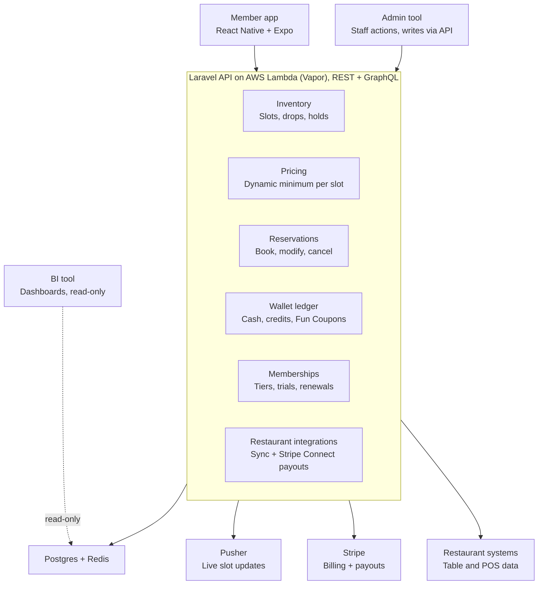

# Service Map (inferred)

The Laravel API likely holds six domains in one codebase; the wallet ledger carries the most risk because every forfeit, credit and coupon must reconcile.

| Domain | Owns |
| --- | --- |
| Inventory | Slots, drops, holds; releases tables on schedule |
| Pricing | Dynamic minimum per slot from urgency, timing, demand |
| Reservations | Book, modify, cancel; the 8-hour cancellation rule |
| Wallet ledger | Cash, credits, Fun Coupons; forfeits and coupon expiry; overage settled at end of meal; staff compensation charged to Dorsia or the venue |
| Memberships | Tiers, trials, renewals via Stripe Billing |
| Restaurant integrations | Sync with restaurant systems; payouts via Stripe Connect |

## Booking flow

1. App asks Inventory for a slot.
2. Pricing sets the minimum.
3. Reservations charges it through the Wallet and Stripe.
4. Pusher broadcasts the slot as taken.